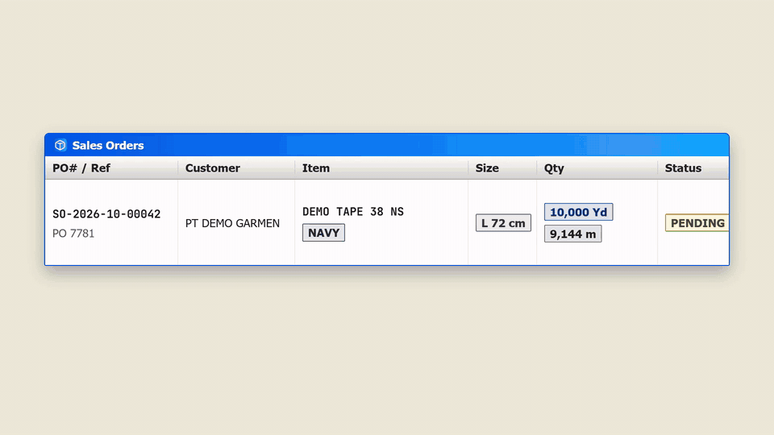

<p align="center">
  
</p>

# Terras ERP

**Current release: v1.0.0** (2026-10-28) — see [`CHANGELOG.md`](CHANGELOG.md).

<p align="center">
  <a href="marketing/terras-v1.mp4"></a>
  <br />
  <sub>37 s, with sound: <a href="marketing/terras-v1.mp4">watch the MP4</a>. All data shown is demo data.</sub>
</p>

**Terras ERP** is a manufacturing and inventory ERP built for textile factories — warping, weaving, dyeing, and finishing lines where lot traceability and shop-floor speed matter as much as the paperwork. It runs the full loop from sales order to production planning, shop-floor execution, dyeing/setting recipes, and dispatch, with every stock movement and QC decision logged for audit.

The stack is **FastAPI + PostgreSQL** on the backend and **Next.js + React** on the frontend.

---

## What it does

- **Sell and source** — Sales Orders with customer POs, reservations from stock and short-close; Purchase Orders with goods receipt that records the supplier's Surat Jalan and lots.
- **Develop samples and colours** — Sample requests with approval notes, photos and a development report; lab-dip colour approval (fabric and yarn) against a Pantone/C.I. colour library; a combo library for multi-colour articles.
- **Plan production** — Sales Orders drive Production Runs, which explode into Manufacturing Orders and Work Orders through a recursive, percentage-based BOM. Shared greige and sub-components across colour and size variants are consolidated into one order instead of duplicated, and material availability nets on-hand plus incoming supply by item, colour and size (Booking Stock, Work Queue).
- **Run the shop floor** — One `/scanner` entry point reads every QR code: operators log Work Order output from a phone or tablet, packers log cartons, pickers scan cartons onto pick lists. Completions post material consumption and auto-numbered output lots; warp beams mount to the loom and draw down FIFO.
- **Monitor machines** — Weaving and dyeing monitors show per-machine efficiency, the running order and beam/bath status, with per-machine production calendars and holidays.
- **Manage dyeing and setting** — Dye recipes with wash-bath and finishing steps, dosing from the bath actually filled, and per-run records of the chemicals weighed, printed on job cards that match the factory's paper forms.
- **Track every lot** — Stock is lot-, colour- and size-aware end to end, held in a Warehouse > Zone > Bin location tree, with a materialized balance table for instant lookups and a backward genealogy trace from any finished lot to its raw inputs.
- **Enforce quality** — Reject grading routes bad output to defect stores, and quarantine locks keep unreleased material out of production and packing without blocking good material next to it.
- **Pack, pick, and ship** — Finished goods are packed into labelled cartons, picked against sales orders, and dispatched on a shipment that carries the Surat Jalan through a four-eyes stage/verify gate before stock leaves the building.
- **Print and report** — Every printed document (SPK, Kartu Kerja, labels, Surat Jalan, PO, SO confirmation) comes from an editable template in the Print Layouts designer. Stock Ledger and Production Output reports, Excel export, and a live KPI dashboard.
- **Administer** — Role-based permissions down to individual codes, a full audit log of every change, database snapshots (dump plus uploaded files) with restore, and an in-app feedback button that files reports to GitHub with screenshots.

Every screen updates live over a WebSocket event bus, without a refresh.

---

## Tech Stack

| Layer | Technologies |
|---|---|
| Backend | Python 3.11, FastAPI, SQLAlchemy 2.0, Alembic, PostgreSQL (the only supported database), Redis |
| Frontend | TypeScript, Node 24, Next.js 14, React 18, Bootstrap 5, [`@bryanadamg/terras-ui`](https://github.com/bryanadamg/terras-ui) |
| Infrastructure | Docker & Docker Compose, optional Caddy for LAN HTTPS |

The interface is a Windows-XP-styled Classic theme with an adjustable interface scale, full English/Indonesian localization, and role-based access control down to individual permission codes.

Shared UI primitives — buttons, chips, status chips, tooltips, form sections, table helpers, skeletons, the login screen and pager — come from **terras-ui** (v1), a separate package published to GitHub Packages. The ERP pages are thin adapters over it, so look there before restyling a control here.

---

## Getting Started

### Prerequisites

Copy `.env.example` to `.env` at the repo root and fill it in. Two values have no default:

- `SECRET_KEY` — the API refuses to start without it (`python -c "import secrets; print(secrets.token_urlsafe(64))"`).
- `NODE_AUTH_TOKEN` — a GitHub token with `read:packages`, so `npm ci` can fetch `@bryanadamg/terras-ui` from GitHub Packages (see `frontend/.npmrc`). The frontend image build passes it in as a build secret; without it the install fails with 401/404.

`INITIAL_ADMIN_PASSWORD` is optional but recommended (see First sign-in below). `FEEDBACK_GITHUB_TOKEN` is optional too — leave it empty and the in-app feedback button reports that it isn't configured.

### Run it

```bash
# Start all services (api, db, redis, frontend)
docker compose up --build -d
```

The app is at http://localhost:3030 (API at http://localhost:8000, interactive docs at http://localhost:8000/docs). On first boot the API container runs database migrations and seeds reference data (UOMs, categories, system attributes, RBAC roles) automatically.

### First sign-in

A fresh install creates exactly one account, `admin`. Its password is `INITIAL_ADMIN_PASSWORD` from `.env`; if that is unset, a random password is generated and printed **once** in the API startup log:

```bash
docker compose logs api | grep "generated password"
```

Change it under Settings > Users after signing in, then create the other accounts there. An account locks for 15 minutes after 10 failed sign-ins.

### LAN HTTPS (scanner on phones)

Phone browsers only allow the camera (QR scanning at `/scanner`) on a secure origin. Set `COMPOSE_PROFILES=https` and `LAN_IP=<server's LAN IP>` in `.env` and Caddy serves the app at `https://<LAN_IP>` with a self-signed local CA. Each phone installs that CA once from `http://<LAN_IP>/ca.crt`. Keep `./caddy_data`: losing it means reinstalling the CA on every phone.

### Hot reload

Layer the dev overlay on top (no rebuild needed for code changes after the first run):

```bash
docker compose -f docker-compose.yml -f docker-compose.dev.yml up -d --build
```

### Local development

```bash
# Backend (from /backend)
uvicorn app.main:app --reload --host 0.0.0.0 --port 8000

# Frontend (from /frontend; NODE_AUTH_TOKEN must be exported for npm install)
npm install
npm run dev    # http://localhost:3000
```

### Tests

```bash
# backend — the image ships no tests, so copy them in first. They run against a
# separate erp_test database on the same server, never the live one.
docker cp backend/tests/. teras-erp-api-1:/app/tests/
docker cp backend/pytest.ini teras-erp-api-1:/app/pytest.ini
docker exec teras-erp-api-1 python -m pytest tests -q            # or tests/test_x.py

cd frontend && npx tsc --noEmit && npm run lint   # frontend type-check + lint
```

CI (`.github/workflows/test.yml`) runs backend pytest plus frontend tsc, lint and build, and deploy waits on it.

---

## Releases

Versions follow SemVer driven by Conventional Commits; see [`CHANGELOG.md`](CHANGELOG.md). The version lives in `/VERSION`, `backend/app/main.py` (`APP_VERSION`, served at `GET /api/health`) and `frontend/package.json`, kept in sync at release time.

---

## License

MIT License — Copyright (c) 2026 Bryan Adam G.
